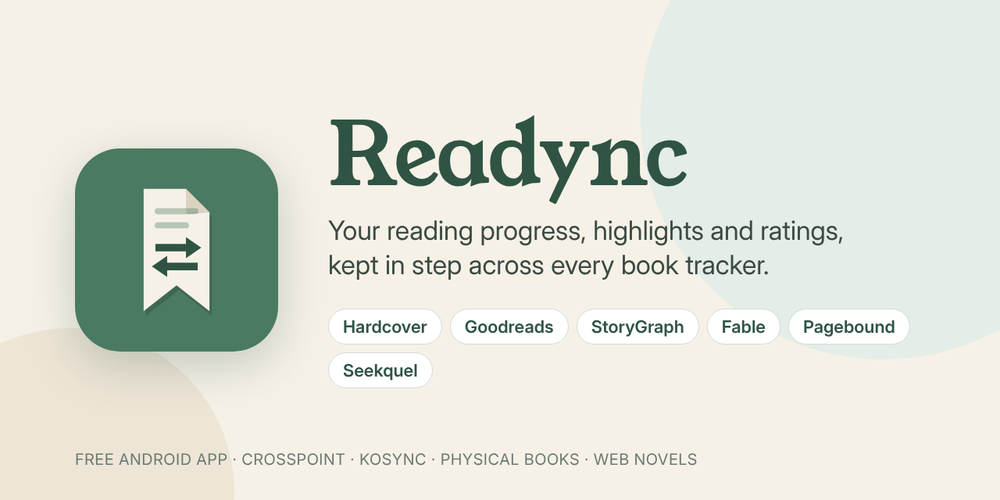

<p align="center">
  
</p>

<p align="center">
  <a href="https://github.com/PrithirajN/Readync/releases/latest"></a>
  <a href="https://github.com/PrithirajN/Readync/releases"></a>
  
  
  <a href="LICENSE"></a>
  
</p>

<p align="center">
  <a href="https://github.com/PrithirajN/Readync/releases/latest"><b>Download the APK</b></a> ·
  <a href="#install">Install</a> ·
  <a href="#features">Features</a> ·
  <a href="#faq">FAQ</a> ·
  <a href="#source-code">Source code</a>
</p>

<p align="center">
  <a href="https://buymeacoffee.com/prithi"></a>
  <a href="https://github.com/sponsors/PrithirajN"></a>
</p>

---

**Readync** is a free Android app that keeps your reading in step everywhere. It reads your progress
and highlights from your e-reader ([CrossPoint Sync](https://sync.crosspointreader.com) or any KOSync
server), from physical books and from web novels. Then it updates **Hardcover**, **Goodreads**,
**StoryGraph**, **Fable**, **Pagebound** and **Seekquel** for you, in the background.

You read, and your trackers keep up. You don't have to update page numbers by hand on six sites.

## Features

### 📚 One sync, every tracker
- Reading progress goes to **Hardcover, Goodreads, StoryGraph, Fable, Pagebound and Seekquel** automatically, every 15 minutes while you're online.
- **Public or private** posting, chosen per tracker.
- Books are matched for you, with **covers and descriptions**. If a book has no clear match, you pick it with one tap.
- **Real reading dates**: start and finish days go to the trackers that take them.

### ✍️ Highlights, ratings and reviews
- **Highlights and notes** are sent too: to Hardcover, StoryGraph and Seekquel by default, and to Goodreads, Pagebound and Fable if you turn them on.
- **Rate once, everywhere.** Star ratings in tenths, plus a review written in Markdown (spoiler tags included), sent to every tracker that accepts them.
- **Share a highlight as a picture**, with your note on it: ten looks (Spotlight, Highlighter, Spine, Editorial, Typewriter, Index card, **Book card** — the passage with the book's real cover, title, series and author, in 15 layouts (cover colour, polaroid, postcard, shelf, ticket, "now reading" and more) —, **System window** — a LitRPG game notification with an experience bar —, **Wordprint** — a mark drawn from the passage itself, one ray per word around a ring showing how far into the book — and a **Book photo** of the passage on a real-looking book page with the actual text of that page around it), coloured from the book's cover, as a feed post, a square or a story. Post one to Threads in a tap, or turn on **Post to Threads** for a book (off for every book until you do) and its new highlights, quotes and notes go up by themselves after a sync, each as a Book card in a layout picked at random, with your note as the post's words (with your own Meta app's token, a few a day at most). When you finish a book, or mark it **Did not finish**, you're offered to post your stars and review, the review as slides to swipe through. Your note can go on the picture as it is or reworded just for it, and a note on its own (a KOReader note on a bookmark) is shared as a note, in handwriting, without quote marks.
- **Export highlights to Readwise, Notion and Obsidian**: every highlight, quote and note, from every source, goes on after each sync. Readwise gets them in your library (with your notes, page and date) for its daily review; Notion gets a page per book with its cover, highlights as quotes and your notes in callouts; Obsidian gets a Markdown note per book in a vault folder you pick, with the book as properties, rewritten when highlights change while anything you write around Readync's part is kept.
- **Reading apps and servers**, linked like crosspoint-sync's connected services: **Audiobookshelf** and **Jellyfin** (your place in the ebook moves the audiobook, and listening ahead moves the book), **BookFusion**, **BookOrbit** and **Readest** (your place both ways), **Readwise Reader** (finished books are archived), **Spotify** audiobooks (listening ahead moves the book; nothing is sent to Spotify), **Micro.blog** (Currently reading and Finished reading shelves, and highlights posted to your blog). A place further along in one of them is asked about on the book, like any other source, unless you say to always use it. CrossPoint books go with their exact place where the app takes one (Audiobookshelf's and BookFusion's readers open right there, and KOSync gets KOReader's own place), highlights go to BookOrbit and Readest at their exact spot in the book, and an audiobook's card on the book's page shows where you're listening, starts Spotify from your place (**Resume in Spotify**) and lets you say which track your reading place is at (**Not the right spot?**), so reading and listening line up. A service linked on your crosspoint-sync server too is never sent the same thing twice: the server sends your CrossPoint books and their highlights, and Readync sends everything else.
- **Snap a page** from a paper book or your e-reader's screen (or a screenshot): a highlighted passage is picked out for you, saved as a highlight and, if you like, turned into a book photo.

### 📖 Any way you read
- **E-readers**: CrossPoint Sync, or KOReader through a KOSync server.
- **KOReader highlights**: straight from KOReader's own files when it runs on the same phone or tablet (no plugin needed), or from the HighlightSync or AnnotationSync plugin on Koofr (or any WebDAV) when it runs elsewhere. They come in under each book, go to your trackers, and can be added to a CrossPoint device too, **on their exact words** so the Xteink draws them on the page (when the book's EPUB is in KOReader's books folder on your phone). Optionally, highlights made on the CrossPoint device go the other way into KOReader, through HighlightSync. A book the plugin knows only by KOReader's ID can be named from a list you have, typed, or **guessed from its highlights' own words** (looked up inside books on Google Books), for you to confirm.
- **Moon+ Reader**: its sync to a free WebDAV storage like Koofr is read, so progress and highlights in Moon+ on your phone or tablet reach your trackers too. Step-by-step setup is in the app.
- **Physical books**: snap a photo of the page you're on, and the page number is read on your phone (offline).
- **Barcode scanning** adds a book from its ISBN.
- **Web novels and fan fiction**: Royal Road, AO3, Scribble Hub, Wattpad and more. The story is linked from the link inside your EPUB (FanFicFare, WebToEpub and similar save it) when Readync can see the file (KOReader's folder on your phone, or your books on WebDAV), or found by title. While you read one, **new chapters are checked for every few hours** through the story's feed (Royal Road, Scribble Hub; others daily) with an alert, the book page shows which chapter you're on and how many are out past your copy, a copy downloaded again with new chapters stays the same book, and a story also published as books shows how many are out and when the next one comes (from Hardcover).

### ✨ And more
- An **SFF news tab** for science fiction and fantasy readers.
- **Home-screen widgets**: a sync card, a progress ring and a shelf of the books you're reading.
- **Quick Settings tile** and app shortcuts (Snap page, Add a book, Sync now).
- **Import your reading history** from a Goodreads, StoryGraph or Hardcover export, KOReader's statistics, or straight from Hardcover and Seekquel, with dates, ratings, reviews, Hardcover's quotes as highlights, and **day-by-day reading** where the source keeps it (KOReader's pages and minutes per day, Hardcover's progress updates). What's already in Readync is kept, and nothing is sent to your trackers. The on-device AI can work out an unfamiliar CSV's columns.
- **Backups and moving phones**: a full backup locked with a password, or your reading data without any sign-ins, which merges into another phone and works across app versions.
- Optional **on-device AI** helpers. Nothing leaves your phone.

## Install

1. Open the **[latest release](https://github.com/PrithirajN/Readync/releases/latest)** on your Android phone.
2. Download `Readync.apk` under **Assets**.
3. Open it. If Android asks, allow installs from your browser.
4. Sign in to CrossPoint Sync, then link your trackers under **Services**.

Readync needs Android 8.0 or newer.

> [!TIP]
> ☕ **Enjoying Readync?** It's free, with no ads and nothing locked, and it's made by one person.
> If it saves you time, [buy me a coffee](https://buymeacoffee.com/prithi) or [sponsor me on GitHub](https://github.com/sponsors/PrithirajN) to help keep it going.

## Updates

**Automatic:** install [Obtainium](https://github.com/ImranR98/Obtainium), then in Readync go to
**Services → App update → Set up in Obtainium**. Obtainium tells you when a new version is out and
installs it.

**By hand:** download the newest `Readync.apk` from [Releases](https://github.com/PrithirajN/Readync/releases)
and install it over your current copy.

Either way, you stay signed in to all your trackers.

## Supported trackers

| Tracker | Progress | Highlights | Rating & review | Reading dates |
| --- | :---: | :---: | :---: | :---: |
| Hardcover | ✅ | ✅ | ✅ | ✅ |
| Goodreads | ✅ | optional | ✅ | ✅ |
| StoryGraph | ✅ | ✅ (journal) | ✅ | ✅ |
| Fable | ✅ | optional | ✅ | ✅ |
| Pagebound | ✅ | optional | ✅ | ✅ |
| Seekquel | ✅ | ✅ | rating | source of dates |

## FAQ

<details>
<summary><b>How do I sync my e-reader with Goodreads or StoryGraph?</b></summary>

Install Readync, sign in with your CrossPoint Sync account and link Goodreads or StoryGraph
under Services. Your progress then updates on its own as you read.
</details>

<details>
<summary><b>Is Readync free?</b></summary>

Yes. There are no ads, no subscription and nothing locked behind a paywall.
</details>

<details>
<summary><b>Where are my passwords kept?</b></summary>

On your phone. Readync talks to each tracker directly from your phone, and only keeps the session
token it needs.
</details>

<details>
<summary><b>Does it work with KOReader?</b></summary>

Yes. Add a KOSync server (KOReader's own, or a self-hosted one) under Services, alongside your CrossPoint Sync account.
</details>

<details>
<summary><b>Does it work with Moon+ Reader?</b></summary>

Yes. Turn on Moon+ Reader's sync to WebDAV (a free Koofr account works), then connect the same account in Readync under Services › Moon+ Reader. The app has a step-by-step guide. Readync only reads Moon+ Reader's sync files; it never changes anything there.
</details>

<details>
<summary><b>Can I track physical books?</b></summary>

Yes. Add the book (or scan its barcode), then snap a photo of the page you're on or type the page
number. The update goes to all your trackers.
</details>

## Source code

This repository has the app's code, so you can read it, learn from it and build your own copy. To be
upfront: **it isn't the complete code of the official app.**

**The official APK (in Releases) is built from a private repository**, from this same code plus parts
that aren't published here:

- **The Book photo studio**, which turns your highlights into photos of real-looking books: the light,
  the desks, the paper, the moods, drawing on the page, and making one from a photo of the page. In this
  code it's a stand-in that shows a plain card instead.

There are also connections that **aren't in the official APK or here**: Kindle, Libby and Audible.
They're only in the developer's own copy. Here they're empty stand-ins, so the code builds the same.

So if you build this repository yourself, you get a working Readync without the Book photo studio. If you
want the studio, use the official APK. It's free.

The stand-ins are in `app/src/stubs/`. When `app/src/private/` exists (only in the private repository),
the build uses the real parts instead.

### Build it yourself

You need JDK 17 and the Android SDK (Android Studio installs both).

```
./gradlew assembleLiteDebug
```

The APK is in `app/build/outputs/apk/lite/debug/`. It's signed with Android's debug key, so it won't
install over the official app (or the other way round): uninstall one before installing the other.

## A note on the trackers

Hardcover and Seekquel have official APIs. Goodreads, StoryGraph, Fable and Pagebound don't, so
Readync talks to them the way their own websites and apps do, using your sign-in, from your phone.
That can break when they change things, and it's up to you to use it within their terms. Readync
isn't affiliated with any of these services.

## Support

<a href="https://buymeacoffee.com/prithi"></a>
<a href="https://github.com/sponsors/PrithirajN"></a>

Readync is free, with no ads and nothing locked. If it's useful to you, you can
[buy me a coffee](https://buymeacoffee.com/prithi) ☕ or [sponsor me on GitHub](https://github.com/sponsors/PrithirajN) 💖. It doesn't unlock anything; it just helps keep the app going.

## Licence

The code here is under the [MIT licence](LICENSE). Fonts, icons and code by others keep their own
licences, listed in [`licenses/`](licenses/). Some of the request handling is based on
[ShelfSync](licenses/shelfsync-LICENSE.txt) (MIT).

---

<p align="center"><sub>Readync · Goodreads sync · StoryGraph sync · Hardcover sync · e-reader reading tracker for Android</sub></p>
